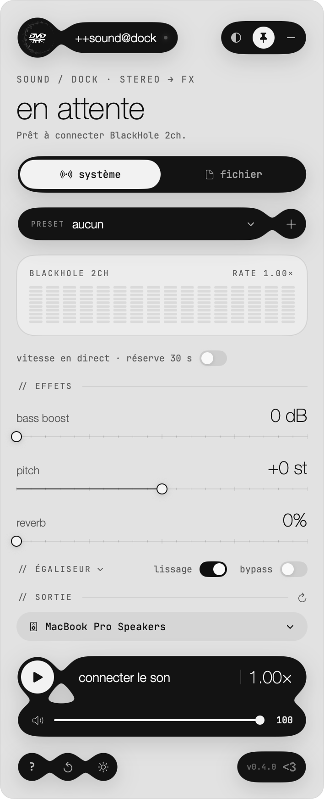
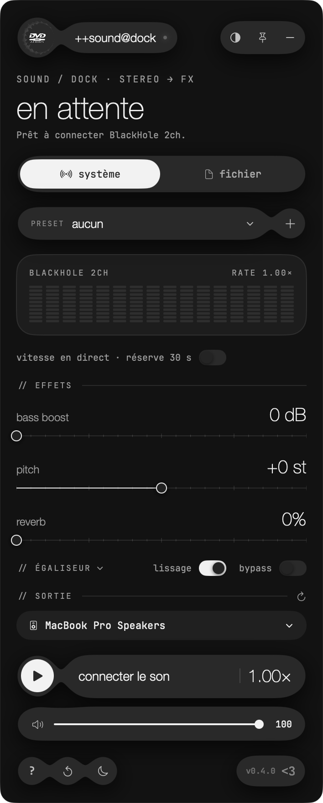

# ++sound@dock

*A small dock for sounds that never quite arrive.*

SOUND / DOCK — AN ONGOING EXPERIMENT

Somewhere behind your speakers, a room is still being imagined.
Everything you hear passes through it first.

A floating panel for macOS, from the same wonderland as [@@ennuienoir](https://github.com/echecnoir11/ennuienoir).
For late songs, borrowed voices, and the hum between two tracks.

<p>
  
  
</p>

*01 / en attente.*

A black ribbon at the top of the screen. A dot that has not lit up yet.
The music is still on the other side of the wall, waiting to be let in.

*02 / Music.wav*

Connect the sound. Sixteen small columns begin to breathe.
Slow it down until a chorus turns into a field note.
Push the bass until the floor remembers it.
Bend the pitch. Leave the reverb open like a door.

*03 / The thirty seconds you keep.*

Play the world a little faster, or a little later.
The dock keeps half a minute in its pocket and spends it carefully.
When it runs out, it waits, and the song catches up.

*04 / light, then noir.*

Grey paper by day. Ink by night.
The same panel, seen from the other side of the room.

---

Open the panel. Touch a few things. Listen to what stays.

macOS 13+ · Apple Silicon · Experimental · Not notarized
System sound needs [BlackHole 2ch](https://github.com/ExistentialAudio/BlackHole). A local file needs nothing.

## Build

```bash
./build.command
```

The app appears in `outputs/++sound@dock.app` (locally signed).

```bash
swift test --disable-sandbox --build-system native
```

The full notes (in French) live in `README.txt` and `Resources/Guide.html`.

[MIT](LICENSE) · JetBrains Mono under SIL OFL 1.1 · [echecnoir](https://www.echecnoir.com)
